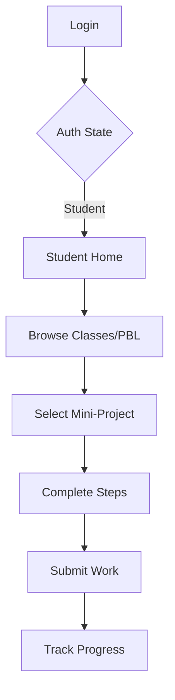
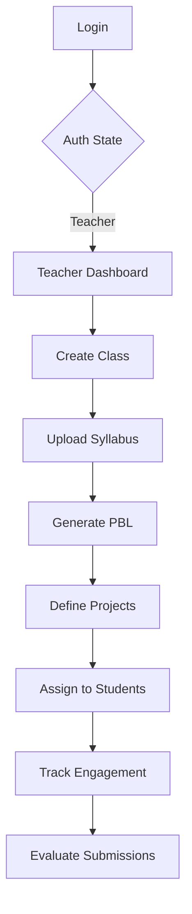

# Class Connect

### Adaptive Mastery & Engagement Platform (AMEP)

Class Connect is a modern, data-driven ed-tech platform designed to support Project-Based Learning (PBL) with structured workflows, real-time engagement tracking, and personalized mastery progression. The platform bridges the gap between traditional classroom teaching and adaptive, student-centric learning.

---

## Quick Start

**View Application Demo:** [class-connect-web.vercel.app](https://class-connect-web.vercel.app/)

---

## Problem Statement

Modern classrooms face several challenges:

* Increasing **teacher workload**
* **Delayed and subjective assessments**
* Limited **personalized learning paths**
* Poor visibility into **student engagement & progress**
* Fragmented tools for projects, assignments, and evaluation

**Class Connect** addresses these challenges by offering a **single unified platform** for managing PBL, tracking progress, and enabling mastery-based learning at scale.

---

## Objectives

* Enable scalable **Project-Based Learning**
* Provide **step-wise mini-project workflows**
* Track **student engagement & completion status**
* Reduce manual effort for educators
* Support **adaptive and mastery-driven education**

---

## Key Features

### Teacher Features

* Create and manage classes with syllabus uploads
* Design PBL collections with AI-generated content
* Define mini-projects and structured step-by-step tasks
* View students enrolled in each mini-project
* Track step completion and submission status
* Monitor real-time student progress via analytics dashboard
* Generate quizzes and evaluate responses using AI
* Track teacher workload and receive productivity insights

### Student Features

* Secure authentication via Firebase
* Browse available mini-projects and select independently
* Follow structured step-by-step tasks with multimedia support
* Submit project work (links, files, images)
* Track personal progress and completion status
* Take quizzes with AI-powered feedback
* Access chatbot assistance for learning support
* Participate in community discussions and Q&A

### Parent Features

* View student attendance analytics
* Monitor assignment and quiz performance
* Access class and teacher information
* Track overall academic progress

### Admin Dashboard

* **Overview Metrics**: Total classes, students, and teachers at-a-glance
* **Class Size Distribution**: Visualize enrollment patterns
* **Quiz Performance Charts**: Track class performance trends
* **Weak Concepts Analysis**: Identify learning gaps across the institution
* **Teacher Workload Analytics**: Monitor educator workload distribution
* **Community Engagement**: Track student participation in discussions
* **Attendance Insights**: Analyze attendance trends and patterns

---

## Technology Stack

### Mobile Application (Flutter)

| Category | Technology |
|----------|------------|
| **Framework** | Flutter (Dart) |
| **State Management** | Flutter native (StreamBuilder, FutureBuilder) |
| **UI/UX** | Material 3, custom dark theme |
| **Backend** | Firebase Auth, Cloud Firestore, Firebase Storage |
| **AI Services** | Google Generative AI (Gemini), Groq API |
| **Media** | image_picker, file_picker, video_player |
| **PDF** | syncfusion_flutter_pdf, pdf |
| **Charts** | fl_chart |
| **Notifications** | flutter_local_notifications |
| **Other** | google_mlkit_text_recognition, share_plus |

### Web Dashboard (React)

| Category | Technology |
|----------|------------|
| **Framework** | React 19 + Vite |
| **UI Library** | MUI (Material UI) 7 |
| **Routing** | React Router DOM 7 |
| **Charts** | Recharts |
| **Language** | TypeScript |
| **Styling** | Emotion (CSS-in-JS), Dark theme with glass-morphism |

### Backend Services

| Service | Technology | Use Case |
|---------|------------|----------|
| **Authentication** | Firebase Auth | Secure login with role-based access |
| **Database** | Cloud Firestore | Real-time NoSQL database |
| **Storage** | Firebase Storage | File uploads, assets |
| **Video** | Supabase | Educational video hosting |

---

## Project Structure

```
├── demo/                    # Flutter mobile application (cross-platform)
│   ├── lib/
│   │   ├── screens/         # UI screens by user role (student/teacher/parent)
│   │   ├── services/        # Firebase, AI, and business logic services
│   │   ├── theme/           # Custom Material 3 theme configuration
│   │   └── widgets/         # Reusable UI components
│   └── pubspec.yaml         # Flutter dependencies
│
└── dasboard-web/            # Admin analytics dashboard (React + Vite)
    ├── src/
    │   ├── pages/           # Dashboard pages (Overview, Classes, Teachers, Students, Parent)
    │   ├── components/      # Charts, tables, and UI components
    │   ├── services/        # Firebase analytics and data services
    │   └── theme/           # MUI dark theme with glass-morphism styling
    └── package.json         # npm dependencies
```

---

## Application Flow

### Student Flow



### Teacher Flow



---

## Getting Started

### Prerequisites

* **Flutter SDK 3.19+** - [Installation Guide](https://docs.flutter.dev/get-started/install)
* **Node.js 18+** - [Installation Guide](https://nodejs.org/)
* **Firebase CLI** - `npm install -g firebase-tools`
* **Google Cloud Account** - For Firebase services

### Mobile App Setup

```bash
cd demo

# Install dependencies
flutter pub get

# Configure environment variables
cp .env.example .env
# Add your API keys (see Environment Variables section)

# Run on device/emulator
flutter run

# Build for platforms
flutter build apk      # Android
flutter build ios      # iOS
flutter build web      # Web
```

### Web Dashboard Setup

```bash
cd dasboard-web

# Install dependencies
npm install

# Configure Firebase
# Edit src/firebase/firebase.ts and add your Firebase project credentials
# (API key, Auth Domain, Project ID, etc.)

# Development server
npm run dev

# Production build
npm run build
npm run preview
```

---

## Configuration

### Environment Variables (`.env`)

#### Flutter Mobile App (`demo/.env`)

```env
# Firebase Configuration
GROQ_API_KEY=your_groq_api_key_here

# AI Services
GROQ_CHAT_API_KEY=your_groq_chat_key_here

# Storage (optional)
SUPABASE_URL=your_supabase_url
SUPABASE_KEY=your_supabase_key
```

#### Web Dashboard (`dasboard-web/src/firebase/firebase.ts`)

The web dashboard uses a direct configuration file. Edit `src/firebase/firebase.ts` to add your Firebase credentials:

```typescript
const firebaseConfig = {
  apiKey: "your_api_key",
  authDomain: "your_project.firebaseapp.com",
  projectId: "your_project_id",
  storageBucket: "your_project.appspot.com",
  messagingSenderId: "your_sender_id",
  appId: "your_app_id",
  measurementId: "your_measurement_id",
};
```

---

## Security & Data Integrity

* **Firebase Authentication** ensures verified users with role-based access
* **Firestore security rules** enforce:
  * Students can only modify their own selections and submissions
  * Teachers can view and manage all enrolled students
  * Parents have read-only access to their child's data
* **One mini-project per student per PBL** (UID-based enforcement)
* **API keys** are loaded from environment variables (never in source control)

---

## Analytics & Insights

The web dashboard provides comprehensive analytics:

| Metric | Description |
|--------|-------------|
| **Overview Cards** | Total Classes, Students, Teachers |
| **Class Size Chart** | Enrollment distribution across classes |
| **Quiz Performance** | Class-wise quiz scores and trends |
| **Weak Concepts** | AI-identified learning gaps by concept |
| **Teacher Workload** | Task distribution and time estimates |
| **Community Engagement** | Discussion activity and participation |
| **Attendance Trends** | Daily/weekly attendance patterns |

---

## AI-Powered Features

* **PBL Generation**: AI creates PBL projects from syllabus content
* **Quiz Creation**: Generate quizzes with multiple question types
* **Answer Evaluation**: AI-powered grading and feedback
* **Concept Validation**: Verify understanding with interactive quizzes
* **Chatbot Assistance**: 24/7 learning support for students
* **Homework Help**: AI explanations for complex topics

---

## Testing

### Flutter Tests

```bash
# Run unit tests
flutter test

# Run with coverage
flutter test --coverage

# Widget tests
flutter test test/widgets/
```

### Web Dashboard Tests

```bash
# Run linter
npm run lint

# Run tests (if configured)
npm test
```

---

## Build Commands

### Flutter Mobile

```bash
# Development
flutter run

# Release builds
flutter build apk --release
flutter build ios --release
flutter build web --release
```

### React Web Dashboard

```bash
# Development
npm run dev

# Production build
npm run build

# Preview production build
npm run preview
```

---

## Roadmap

* [ ] **Engagement Index** - Advanced student engagement scoring
* [ ] **Mastery Scoring** - AI-based competency measurement
* [ ] **Parent Portal** - Real-time parent access and notifications
* [ ] **Offline Support** - Offline progress synchronization
* [ ] **Advanced Analytics** - ML-powered predictive insights
* [ ] **Multi-Language** - Localization for diverse classrooms

---

## Team

**Class Connect Team**

An initiative focused on adaptive learning, mastery, and engagement.

---

## Resources

* [Firebase Documentation](https://firebase.google.com/docs)
* [Flutter Documentation](https://docs.flutter.dev)
* [React Router](https://reactrouter.com)
* [Recharts](https://recharts.org)